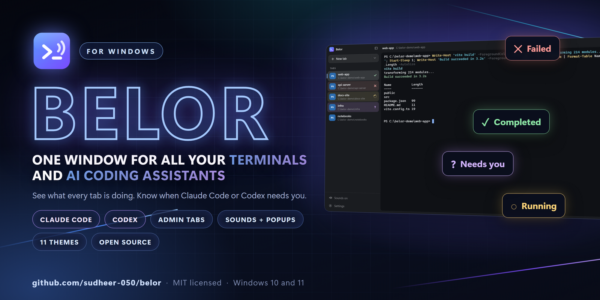
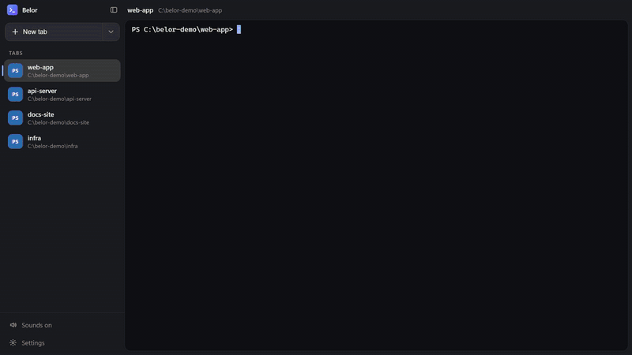
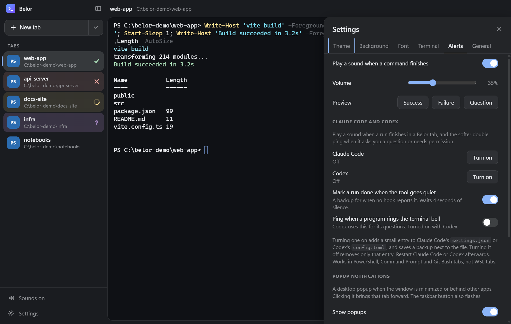
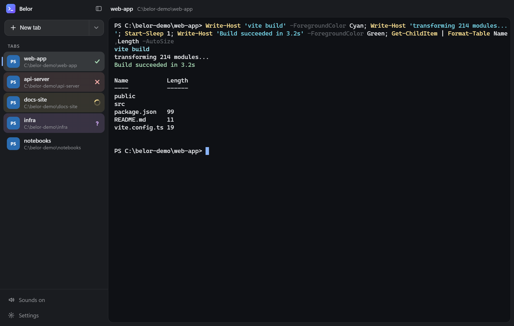
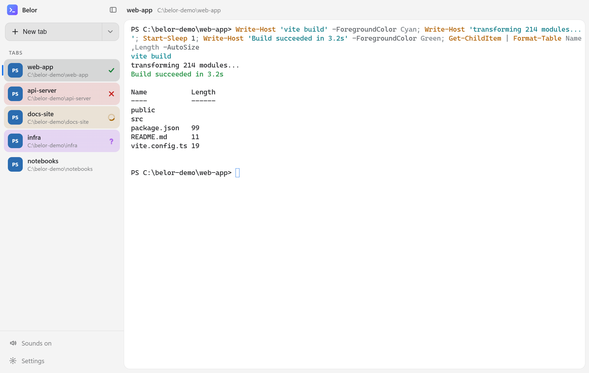
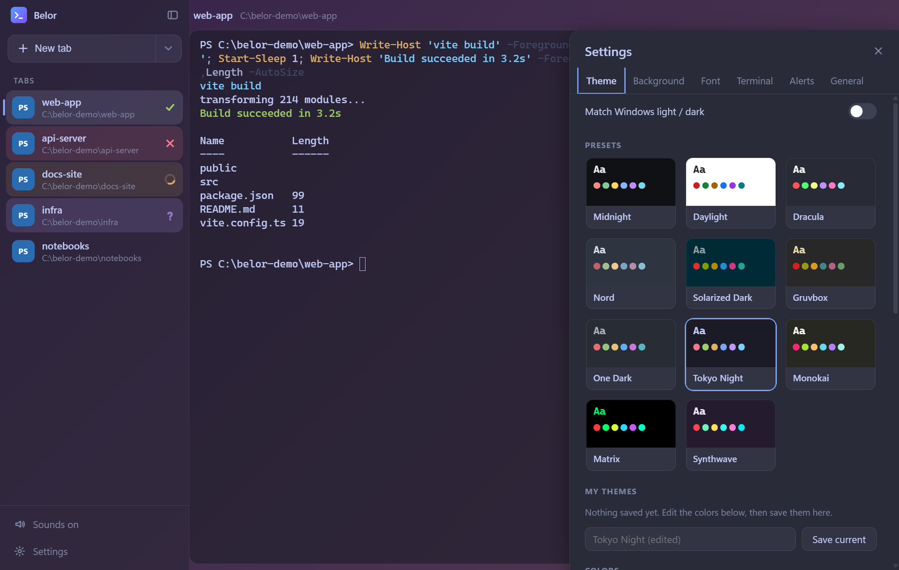
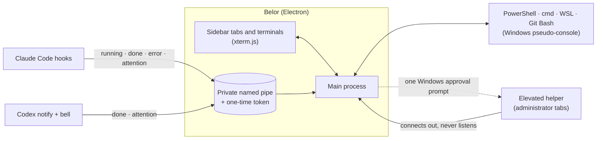

# ⚡ Belor

<div align="center">

<p align="center">
  
</p>

```
 ____  _____ _      ___  ____
| __ )| ____| |    / _ \|  _ \
|  _ \|  _| | |   | | | | |_) |
| |_) | |___| |___| |_| |  _ <
|____/|_____|_____|\___/|_| \_\
```

### One window for all your terminals and AI coding assistants

**See what every tab is doing. Know the moment Claude Code or Codex finishes, fails, or needs you.**  
*No more tab-hunting. No more "is it done yet?". No second window for admin.*

---

[](https://github.com/sudheer-050/belor/releases)
[](#-install)
[](https://github.com/sudheer-050/belor/actions/workflows/test.yml)
[](https://www.electronjs.org/)
[](https://xtermjs.org/)
[](#-security-and-privacy)
[](LICENSE)

[What It Does & Doesn't](#-overview-what-belor-does-vs-what-it-doesnt-do) • [Benefits](#-benefits-of-using-belor) • [Use Cases](#-what-you-can-do-with-belor) • [Who Is This For?](#-who-is-this-for) • [Install](#-install) • [Claude Code & Codex](#-claude-code-and-codex) • [Security](#-security-and-privacy) • [Architecture](#-architecture) • [Status](#-status-and-honest-limits)

---

<p align="center">
  
</p>

**[▶ Watch the 52-second demo with sound (MP4)](assets/demo.mp4)**  
<sub>The demo is a real recording of the app driven by a script. The "Claude Code" in it is a clearly labeled stand-in program that sends the same events Claude Code's hooks send, so no AI model was called. See [`tools/demo-session.js`](tools/demo-session.js).</sub>

</div>

## 🎯 Overview: What Belor Does vs. What It Doesn't Do

Running several builds, servers and AI coding sessions at once means constantly asking one question: *which one needs me?* Belor answers it at a glance, and tells you when you are not even looking.

### ✅ What Belor Does

* **Shows every tab's state.** A spinner while a command runs, a green tick when it completes, a red cross when it fails, a purple question mark when something is waiting for you. A new tab stays plain until something runs in it.
* **Follows Claude Code and Codex.** Runs started in a tab appear like any command: *running* while the tool works, *completed* when it finishes, *failed* on an error, *waiting* when it asks a question or needs permission.
* **Alerts you in the way you will notice.** A distinct sound for success, failure and questions. When the window is minimized or behind other apps you get a desktop popup, the taskbar button flashes, and clicking the popup jumps to that tab.
* **Opens administrator tabs in the same window.** An elevated shell beside your normal tabs, after one Windows approval prompt for the session. Normal tabs stay non-elevated.
* **Hosts real shells.** PowerShell, PowerShell 7, Command Prompt, WSL and Git Bash through the Windows pseudo-console ([xterm.js](https://xtermjs.org/) + [node-pty](https://github.com/microsoft/node-pty)), so `vim`, `ssh`, colors, links and full-screen programs work.
* **Bends to your taste.** 11 theme presets or your own colors, gradient and image backgrounds, any installed font or your own font file, transparency, and the everyday terminal settings (find in history, clickable links, zoom, scrollback, copy on select, multi-line paste protection, reopen tabs).

### ❌ What Belor Does NOT Do

* **Does NOT control your AI tools.** It only listens for "running / done / error / needs you". It never sends them input, never reads your code, and never calls a model.
* **Does NOT send anything anywhere.** The app's own code makes no network requests and has no telemetry. Links open in your browser only when you click them.
* **Does NOT touch your shell profile or registry.** The status hook is handed to each shell at start-up only.
* **Does NOT edit Claude Code or Codex settings on its own.** Only when you click **Turn on**, and then only its own entries, with a backup beside the file and a one-click undo.
* **Does NOT need administrator rights to install.** The installer is per-user. Admin tabs are opt-in, per tab.
* **Does NOT run on macOS or Linux (yet).** Windows 10 and 11 (x64) only.

---

## 🏆 Benefits of Using Belor

| Benefit | Juggling plain terminals | With Belor |
| :--- | :--- | :--- |
| **👀 Know without clicking** | Click through tabs or windows to find which finished. | Every tab carries a spinner, tick, cross or question mark. One glance at the sidebar. |
| **🤖 AI sessions stop being a black box** | You come back to find Claude Code has been waiting on a permission prompt for twenty minutes. | A purple question mark, a soft double ping and a popup the moment it needs you. |
| **🔔 Alerts when you are away** | Nothing tells you a long build is done while you are in another app. | Sounds plus a desktop popup (and a flashing taskbar button) when the window is in the background. Click it to land on the right tab. |
| **🛡️ Admin without the second window** | Right-click, Run as administrator, now you have a second terminal to find. | `Ctrl+Shift+A`: an elevated tab beside the others, clearly marked with a red shield. |
| **🎨 It looks like yours** | One fixed theme. | 11 presets, your own colors, gradients, images, fonts, transparency. |
| **🔒 Nothing leaves your PC** | Many assistants and dashboards phone home. | Zero network requests from the app's own code. Open source (MIT) so you can check. |

---

## 💼 What You Can Do With Belor

```
┌────────────────────────────────────────────────────────────────────────────────┐
│                              REAL-WORLD SCENARIOS                              │
├────────────────────────────────────────────────────────────────────────────────┤
│ 1. Three AI coding sessions at once                                            │
│    Run Claude Code in one repo, Codex in another, a dev server in a third.     │
│    The sidebar shows which is working, which finished, which is asking you.    │
│                                                                                │
│ 2. A long build while you do something else                                    │
│    Start it, switch to your editor or browser, and get a popup with the        │
│    result. Click the popup to land on that tab.                                │
│                                                                                │
│ 3. Fixing a flaky test run                                                     │
│    Keep the failing run's tab, with its red cross and full output, while you   │
│    work in another tab. Find in history with Ctrl+Shift+F.                     │
│                                                                                │
│ 4. System work next to normal work                                             │
│    Keep an elevated tab open for services and installs without leaving a       │
│    second, easy-to-forget admin window around.                                 │
│                                                                                │
│ 5. A terminal that matches your setup                                          │
│    Pick a theme, drop in a wallpaper, set the transparency, bring your         │
│    favorite coding font. Reopen your tabs next time.                           │
└────────────────────────────────────────────────────────────────────────────────┘
```

---

## 👥 Who Is This For?

| Persona | The daily frustration | Why Belor helps |
| :--- | :--- | :--- |
| 🤖 **Developers using AI coding assistants** | Several Claude Code or Codex sessions, and no idea which one is stuck on a permission prompt. | Each run shows up in the sidebar like a command, with a sound and popup when it needs you. |
| 🛠️ **Full-stack and backend developers** | A watcher, a dev server, a test run, and a build, all in different tabs. | State at a glance, and a tab that stays red until you look at it. |
| 🧰 **DevOps and sysadmins on Windows** | Constant switching between normal and elevated shells. | Admin tabs inside the same window, clearly marked. |
| 🎓 **Students and learners** | A wall of identical black tabs. | Color, marks and names (rename with `F2`) make each one recognizable. |
| 🎨 **People who care how their tools look** | The default terminal is the default terminal. | Themes, gradients, images, fonts, transparency, all live. |

---

## 🚨 The 5 Silent Time-Sinks of Juggling Terminals

| # | The problem | What actually happens | How Belor handles it |
|---|---|---|---|
| **1** | **The finished build nobody noticed** | The build ended ten minutes ago; you were in another window. | A popup and a flashing taskbar button the moment it finishes. |
| **2** | **The AI waiting on you** | An assistant paused for permission and quietly sat there. | Purple question mark, soft double ping, popup. |
| **3** | **The red run you lost** | You opened a new tab and forgot which one had the failure. | The failed tab keeps its red cross until you run something else in it. |
| **4** | **The forgotten admin window** | An elevated terminal left open somewhere, looking like any other. | Admin tabs carry a red shield, a red border and an ADMINISTRATOR label. |
| **5** | **Settings you can't see change** | Customizing a terminal means editing a JSON file and reloading. | Every setting changes the window live. |

---

## 📥 Install

**Requirements:** Windows 10 or 11 (x64).

1. Download **`Belor Setup 0.7.0.exe`** from the [Releases](../../releases) page.
2. Run it. It installs per user and needs no administrator rights.
3. Open **Belor** from the Start menu or the desktop shortcut.

> ⚠️ The installer is **not code-signed yet**, so Windows SmartScreen will say the publisher is unknown. Choose **More info**, then **Run anyway**. The release notes list the file's SHA-256 so you can verify the download, and every line of source is in this repository.

### Build from source

```sh
git clone https://github.com/sudheer-050/belor.git
cd belor
npm install
npm start            # run from source
npm run dist         # build the installer into dist\
```

Needs Node.js 20 or newer. `node-pty` ships prebuilt Windows binaries, so no compiler is required.

---

## ⚡ Quickstart in 4 Steps

1. **Open a tab.** Press `+ New` and pick a shell, or hit `Ctrl+Shift+T`.
2. **Run something.** Watch its tab: spinner, then tick or cross.
3. **Turn on your AI tools.** Open **Settings** (`Ctrl+,`), then **Alerts**, and click **Turn on** for Claude Code and/or Codex. Restart the tool.
4. **Go do something else.** Belor will ping you, and pop up if the window is in the background.

<p align="center">

</p>

---

## 🤖 Claude Code and Codex

Once turned on, each tool reports to the tab it started in:

| What the tool does | What you see in the sidebar | Sound |
|---|---|---|
| You send a prompt | 🟡 spinner (running) | none |
| It finishes | ✅ green tick (completed) | rising chime |
| It ends on an error (Claude Code) | ❌ red cross (failed) | low buzz |
| It asks a question or needs permission | 🟣 purple question mark (waiting) | soft double ping |

<details>
<summary><b>How it works, and exactly what it changes</b></summary>

* Each tab's shell gets `BELOR_PIPE`, `BELOR_TAB` and `BELOR_TOKEN`. A small hook script ([`shell/st-notify.ps1`](shell/st-notify.ps1)) reports `running`, `done`, `error` or `attention` over a **private named pipe**; the app checks the token and updates that tab.
* **Claude Code**: adds hooks to `~/.claude/settings.json` for `UserPromptSubmit`, `Stop`, `StopFailure`, `PermissionRequest`, `Notification`, and `PreToolUse` on `AskUserQuestion`.
* **Codex**: adds a `notify` line and a `[tui]` bell setting to `~/.codex/config.toml`. Codex runs only one `notify` program, so if you already have one (the Codex app installs its own), Belor **keeps it**: its hook runs first and then starts yours with the same arguments. Turning Codex off puts your original line back.
* **Safe edits.** Belor changes only its own entries, saves a one-time backup (`*.belor.bak`) beside the file, refuses to touch a file it cannot parse, and **Turn off** removes only what it added. This is covered by [automated tests](test/agent-setup.js) that run against temporary folders, including upgrades from the app's earlier name.
* **Without hooks**, a run is still marked done after 4 seconds of silence from the tool (a switch in Settings).
* Works in PowerShell, Command Prompt and Git Bash tabs, not WSL tabs. Codex does not report failures, so Codex tabs never show failed.

</details>

---

## 🖼️ Screenshots

<p align="center">


</p>
<p align="center">

</p>

---

## 🎨 Make It Yours

| Area | What you can change |
|---|---|
| **Theme** | 11 presets (Midnight, Daylight, Dracula, Nord, Solarized, Gruvbox, One Dark, Tokyo Night, Monokai, Matrix, Synthwave) or your own: background, text, cursor, selection, accent and all 16 text colors. Save your own, copy one as JSON, import one. Follows Windows light/dark if you like. |
| **Tab colors** | The color of running, completed, failed and waiting tabs. |
| **Background** | Theme color, solid color, gradient (presets or your own 2 to 6 colors and angle), or any image (drop it on the window). Blur, dimming, and separate transparency for the terminal and sidebar. |
| **Font** | Pick from a list that detects what is installed, type any installed font, or add a `.ttf`, `.otf`, `.woff` or `.woff2`. Size, weight, line height, letter spacing, cursor style. |
| **Terminal** | Scrollback, wheel speed, copy on select, right-click behavior, confirm multi-line paste, word separators, minimum contrast, emoji width. |
| **Window** | Always on top, opacity, confirm before closing, starting folder, reopen last time's tabs. |

---

## 🔐 Security and Privacy

* **No network.** The app's own code makes no network requests and sends no telemetry. (You can check: there are no URLs and no network calls in `src/`.)
* **Private pipes.** The app listens on a random named pipe; the status hook must present a one-time token to use it. Input is validated and rate-limited.
* **Safe admin tabs.** Administrator tabs run in a **separate elevated helper** that *connects out* to the app and never listens, so another program cannot connect to it and get an admin shell. The helper picks the shell program from its own list rather than from anything the app sends, and exits, taking its shells with it, when the app closes.
* **A hardened window.** Sandboxed renderer, context isolation, a strict content security policy, no navigation or new windows.
* **Honest limit.** The one-time token is on the helper's command line while it starts, so a program already running as you could read it and pose as the helper. That would let it *see what you type into admin tabs*, not run commands as administrator. Treat an admin tab like any elevated terminal.

---

## 🏗️ Architecture



### How the status marks are detected

| Shell | Method | Accuracy |
|---|---|---|
| PowerShell, PowerShell 7 | [`shell/pwsh-init.ps1`](shell/pwsh-init.ps1) wraps your prompt and prints an `OSC 133;D;<status>` marker after each command. Your profile still loads. | Exact |
| WSL, Git Bash | `PROMPT_COMMAND` prints the same marker with `$?`. | Exact |
| Command Prompt | cmd has no exit-code hook, so Belor watches for the prompt to return and looks for common error text. | Best effort |

---

## ⌨️ Shortcuts

| Action | Keys |
|---|---|
| New tab / new **administrator** tab | `Ctrl+Shift+T` / `Ctrl+Shift+A` |
| Close tab, next tab | `Ctrl+Shift+W`, `Ctrl+Tab` |
| Find in this tab, clear | `Ctrl+Shift+F`, `Ctrl+Shift+K` |
| Zoom in / out / reset | `Ctrl +`, `Ctrl -`, `Ctrl 0` (or Ctrl + mouse wheel) |
| Collapse sidebar, full screen | `Ctrl+Shift+B`, `F11` |
| Settings | `Ctrl+,` |
| Rename a tab | `F2` or double-click |

---

## 🧪 Tests

```sh
node test/agent-setup.js             # Claude Code / Codex config editing (temporary folders only)
node test/pty-markers.js             # PowerShell success/failure markers
node test/bash-markers.js wsl        # WSL markers
node test/bash-markers.js gitbash    # Git Bash markers
```

The first test also runs in CI on every push. The marker tests need real shells, so they run locally. The demo video is made by a script too: [`tools/demo-session.js`](tools/demo-session.js), [`tools/make-demo-assets.js`](tools/make-demo-assets.js) and [`tools/make-banner.js`](tools/make-banner.js).

---

## ⚠️ Status and Honest Limits

Belor is an early release (0.x) made by one person. Things to know:

* **Windows only.** The installer is **unsigned**.
* **Admin tabs** were built and tested with the Windows approval step simulated. Please report anything odd with the real prompt.
* Claude Code and Codex awareness works in PowerShell, Command Prompt and Git Bash tabs, **not WSL tabs**.
* **Codex does not report failures**, so Codex tabs show running and completed but never failed.
* In **Command Prompt** tabs the success and failure marks are a best guess.
* Popups are reliable for the **installed** app and follow your Windows notification and Focus assist settings.
* Not built yet: split panes, custom keyboard shortcuts, a command palette.

---

## 🗺️ Roadmap

- [ ] AI panel: ask about your system, review a proposed command, then run it in the terminal
- [ ] Split panes and custom keyboard shortcuts
- [ ] Exact exit codes for Command Prompt
- [ ] Code signing for the installer
- [ ] More AI tools beyond Claude Code and Codex

Have an idea or found a bug? [Open an issue](https://github.com/sudheer-050/belor/issues).

---

## 🙏 Credits

Built with [Electron](https://www.electronjs.org/), [xterm.js](https://xtermjs.org/) and [node-pty](https://github.com/microsoft/node-pty).

## 📄 License

[MIT](LICENSE) © 2026 Sudheer Kumar Gandiboyana
