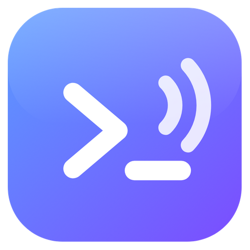

<p align="center"></p>

<h1 align="center">Belor</h1>

<p align="center"><b>One window for all your terminals and AI coding assistants.</b><br>
See what every tab is doing at a glance, and get told when Claude Code or Codex finishes, fails, or needs you.</p>

<p align="center"></p>

Belor is a Windows desktop terminal that keeps PowerShell, Command Prompt, WSL and Git Bash in a sidebar of tabs. Each tab is color-coded by what is happening in it, so with several builds, servers and AI sessions running you can tell which one needs you without clicking through them.

## What it does

- **Every tab shows its state.** A spinner while a command runs, a green tick when it completes, a red cross when it fails, a purple question mark when something is waiting for you. A new tab stays plain.
- **Built for AI coding assistants.** Run `claude` or `codex` in a tab and Belor follows each run: running while it works, a tick when it finishes, a cross on an error, a question mark when it asks you something or needs permission.
- **Alerts you will notice.** A distinct sound for success, failure and questions. When the window is minimized or behind other apps you get a desktop popup, and clicking it jumps to that tab.
- **Administrator tabs in the same window.** Open an elevated shell next to your normal tabs, with one Windows approval prompt for the session. No second window.
- **Customizable.** 11 theme presets or your own colors, gradient and image backgrounds, any font (including your own font file), cursor, scrollback, transparency and more. Settings change the window live.
- **A real terminal.** Real Windows shells through ConPTY ([xterm.js](https://xtermjs.org/) and [node-pty](https://github.com/microsoft/node-pty)), so `vim`, `ssh`, colors, links and full-screen programs work. Find in history, clickable links, zoom, copy on select, multi-line paste protection.

<p align="center">


</p>

## Install

**Requirements:** Windows 10 or 11 (x64).

Download the installer from the [Releases](../../releases) page, or build it yourself (below). The installer is per-user and needs no administrator rights.

> The installer is **not code-signed**, so Windows SmartScreen will say the publisher is unknown. Choose **More info**, then **Run anyway**. You can read every line of the source in this repo.

## Build from source

```sh
git clone https://github.com/sudheer-050/belor.git
cd belor
npm install
npm start            # run from source
npm run dist         # build the installer into dist\
```

Needs Node.js 20 or newer. `node-pty` ships prebuilt Windows binaries, so no compiler is required.

## Claude Code and Codex

Open **Settings, Alerts** and click **Turn on** for each tool. Belor then reports each run to the tab it started in.


How it works:

- Each tab's shell gets `BELOR_PIPE`, `BELOR_TAB` and `BELOR_TOKEN`. A small hook script (`shell/st-notify.ps1`) reports `running`, `done`, `error` or `attention` over a private named pipe. The app checks the token and updates that tab. Nothing leaves your machine.
- **Claude Code**: adds hooks to `~/.claude/settings.json` for `UserPromptSubmit`, `Stop`, `StopFailure`, `PermissionRequest`, `Notification` and `PreToolUse` on `AskUserQuestion`.
- **Codex**: adds a `notify` line and a `[tui]` bell setting to `~/.codex/config.toml`. Codex runs only one `notify` program, so if you already have one (the Codex app installs its own), Belor keeps it: its hook runs first and then starts yours with the same arguments. Turning Codex off puts your line back.
- **Safe edits.** Belor changes only its own entries, saves a one-time backup next to the file (`*.belor.bak`), refuses to touch a file it cannot parse, and **Turn off** removes only what it added.
- **Without hooks**, a run is still marked done after 4 seconds of silence from the tool (a switch in Settings).

## Administrator tabs

From the `+ New` menu or `Ctrl+Shift+A`. The first one starts a small elevated helper through the standard Windows approval prompt, and later admin tabs reuse it. Normal tabs stay non-elevated. Admin tabs carry a red shield and a red border.

The app listens on a private named pipe and the elevated helper connects out to it and proves it knows a one-time token. The helper never listens, so another program cannot connect to it and get an admin shell; it picks the shell program from its own list rather than from the app; and it exits, taking its shells with it, when the app closes.

Limit: the token is on the helper's command line while it starts, so a program already running as you could read it and pose as the helper. That would let it see what you type into admin tabs, not run commands as administrator. Treat an admin tab like any elevated terminal.

## How the status marks work

| Shell | Method | Accuracy |
|---|---|---|
| PowerShell, PowerShell 7 | `shell/pwsh-init.ps1` wraps your prompt and prints an `OSC 133;D;<status>` marker after each command. Your profile still loads. | Exact |
| WSL, Git Bash | `PROMPT_COMMAND` prints the same marker with `$?`. | Exact |
| Command Prompt | cmd has no exit-code hook, so Belor watches for the prompt to return and looks for common error text. | Best effort |

Nothing is written to your profile or registry; the hook is passed to the shell on start-up only.

## Shortcuts

`Ctrl+Shift+T` new tab, `Ctrl+Shift+A` admin tab, `Ctrl+Shift+W` close, `Ctrl+Tab` next, `Ctrl+Shift+F` find, `Ctrl+Shift+K` clear, `Ctrl +` / `Ctrl -` / `Ctrl 0` zoom, `Ctrl+Shift+B` collapse the sidebar, `F11` full screen, `Ctrl+,` settings.

## Status and limits

Belor is an early release (0.x) made by one person. Things to know:

- Windows only. The installer is unsigned.
- Claude Code and Codex awareness works in PowerShell, Command Prompt and Git Bash tabs, not WSL tabs.
- Codex does not report failures to its `notify` hook, so Codex tabs show running and completed but never failed.
- In Command Prompt tabs the success and failure marks are a best guess.
- Windows shows popups reliably only for the installed app, and they follow your Windows notification and Focus assist settings.
- Not built yet: split panes, custom keyboard shortcuts, a command palette, an AI panel.

## Tests

```sh
node test/pty-markers.js             # PowerShell success/failure markers
node test/bash-markers.js wsl        # WSL markers
node test/bash-markers.js gitbash    # Git Bash markers
node test/agent-setup.js             # Claude Code / Codex config editing (temp folders only)
```

## Roadmap

- AI panel: ask about your system, review a proposed command, then run it in the terminal
- Split panes and custom keyboard shortcuts
- Exact exit codes for Command Prompt
- Code signing for the installer

## Credits

Built with [Electron](https://www.electronjs.org/), [xterm.js](https://xtermjs.org/) and [node-pty](https://github.com/microsoft/node-pty).

## License

[MIT](LICENSE) © 2026 Sudheer Kumar Gandiboyana
